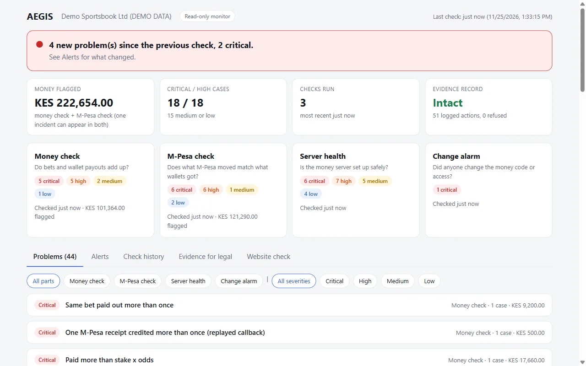

# AEGIS

**Authorized Engagement & Guarded Inspection Suite**: an authorization-first, read-only assessment and money-integrity watchdog, plus a defence map of the AI-driven pentest platform it was built to counter.



*The AEGIS dashboard running on its built-in demo data (a made-up sportsbook with planted problems).*

## What's in this repository

| Part | Folder | What it is |
| --- | --- | --- |
| **AEGIS** | [`aegis/`](aegis/) | A Python package and CLI that assesses a system only inside a signed, time-boxed scope, checks whether the money adds up, and writes every action to a tamper-evident audit log. Full guide: [`aegis/README.md`](aegis/README.md). |
| **ARTEX defence map** | [`01-recon-discovery`](01-recon-discovery/) … [`10-defense-signals`](10-defense-signals/) | A capability-by-capability breakdown of ARTEX, an open-source LLM-driven autonomous pentest platform, written to build detection and defence services for Kenyan banks. Start at [`INDEX.md`](INDEX.md). |

## AEGIS in brief

- **Authorization first.** Nothing runs unless the target is inside an HMAC-signed scope and within the authorized time window. A tampered scope fails verification and the run stops.
- **Read-only by default.** It inspects reachability, configuration and exposure. Money-handling endpoints are only probed with GET, HEAD and OPTIONS; moving money or manipulating bets is deliberately not automated.
- **Evidence a lawyer can rely on.** Every grant, refusal and result goes into a hash-chained audit log; changing any past entry breaks every later hash, and `verify-audit` re-checks the chain. Each log records the SHA-256 of the build that produced it.
- **Transparent.** Requests carry an honest User-Agent naming the engagement, so the client's own team sees the test in their logs.
- **Zero dependencies.** The core is pure Python standard library (3.10+). Optional drivers add MySQL/MariaDB, PostgreSQL, SQL Server and Oracle.

### What it checks

| Module | Question it answers |
| --- | --- |
| Ledger watchdog | Do bets and wallet payouts add up? (bets paid twice, payouts above stake × odds, and more) |
| M-Pesa guard | Does what M-Pesa actually moved match what the wallets were credited? (replayed callbacks, duplicate receipts) |
| Server check-up | Is the money server set up safely? |
| Tamper alarm | Did anyone change the money code, access settings or database triggers? |
| Passive / web intel | What does the public footprint of a website reveal? |
| Connectivity / settlement | What can an authorized tester reach, including internal settlement hosts, and are those endpoints hardened? |

A dashboard (`aegis ui`) shows status, problems, alerts, history and an evidence view for legal review.

## Quick start

```bash
# Install (Python 3.10+). Optional database drivers: pip install ".[mysql,postgres]"
pip install .

# See it work end to end on built-in demo data: builds every demo, runs each module,
# compares with the planted answer keys and verifies each audit chain.
python -m aegis selftest

# Open the dashboard on demo data (localhost only)
python -m aegis ui --demo

# One-shot website check: refuses to run without an authorization acknowledgement
python -m aegis assess --domain example.co.ke --acknowledge "Jane Counsel (engagement letter)" --out assess1
```

A single-file release (`.pyz`) and a checksummed Linux installer can be built with `python packaging/build.py`. The full workflow (signed scopes, stages, the database identifier and the installed guard) is in [`aegis/README.md`](aegis/README.md).

## The boundary AEGIS will not cross

Active money-logic testing (submitting bets, replaying "you won" events, changing stake, odds or payout) is never automated. That work is done by hand, with a client-provisioned test account, under a per-action authorization, following [`aegis/SETTLEMENT-TESTING.md`](aegis/SETTLEMENT-TESTING.md). Automating money manipulation is exactly the operator-risk failure mode documented in the ARTEX defence map.

## Licence

[AGPL-3.0](LICENSE). The ARTEX source files quoted under each segment's `src/` folder are upstream ARTEX code, also AGPL-3.0, included for review only; nothing here runs ARTEX. See [`aegis/IP-ATTRIBUTION.md`](aegis/IP-ATTRIBUTION.md).

## Author

**Felix Kariuki**, backend & DevOps engineer · [Portfolio](https://101feliki.github.io) · [LinkedIn](https://www.linkedin.com/in/felixwachirakariuki) · [GitHub](https://github.com/101feliki)
